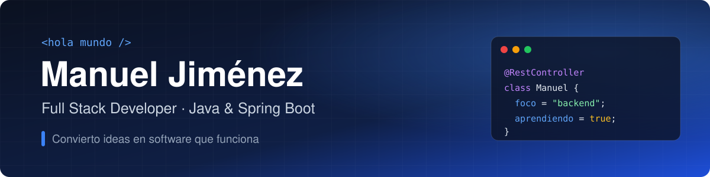

<!-- ═══════════════ CABECERA ═══════════════ -->

  

  
  
  
  

  

 

<!-- ═══════════════ SOBRE MÍ ═══════════════ -->
## 🧑‍💻 Sobre mí

Primero entiendo el problema y después construyo la solución.

Me centro en el **backend con Java y Spring Boot**: APIs REST seguras, bien documentadas y cubiertas por tests. También trabajo el frontend y el desarrollo Android cuando el proyecto lo pide.

- 🎓 **Máster en Full Stack Development** · **CFGS en Desarrollo de Aplicaciones Multiplataforma (DAM)**
- 🔭 Ahora mismo: profundizando en **Java 21, Spring Boot y testing**

<!-- ═══════════════ CIFRAS ═══════════════ -->

  
  
  

 

<!-- ═══════════════ PROYECTOS ═══════════════ -->
## 🚀 Proyectos destacados

<table>
<tr>
<td width="33%" valign="top">

### 🏦 API REST · Sistema bancario
Gestión de clientes, cuentas, tarjetas y transacciones.

✅ Autenticación **JWT** y roles 
✅ Documentación **OpenAPI / Swagger** 
✅ **56 tests** · **84 %** de cobertura

</td>
<td width="33%" valign="top">

### 🏠 Domus
App Android de finanzas personales y del hogar.

</td>
<td width="33%" valign="top">

### 🌐 Portfolio personal
Web bilingüe (ES / EN) con mis proyectos y stack.

</td>
</tr>
</table>

 

<!-- ═══════════════ STACK ═══════════════ -->
## 🛠️ Stack tecnológico

<table align="center">
<tr>
<td align="center" width="140"><b>Backend</b></td>
<td></td>
</tr>
<tr>
<td align="center"><b>Frontend</b></td>
<td></td>
</tr>
<tr>
<td align="center"><b>Bases de datos</b></td>
<td></td>
</tr>
<tr>
<td align="center"><b>Móvil</b></td>
<td></td>
</tr>
<tr>
<td align="center"><b>Herramientas</b></td>
<td></td>
</tr>
</table>

  <b>También:</b> Spring Security · JWT · JPA / Hibernate · MapStruct · OpenAPI · JUnit 5 · Mockito · MockMvc · H2 · Google Apps Script

 

<b>📜 Certificaciones</b>

 

- Java y Programación Orientada a Objetos
- Python Essentials 1 y 2
- JavaScript Essentials
- Introducción al Desarrollo Web
- Introducción a Apps Móviles

 

<!-- ═══════════════ ESTADÍSTICAS ═══════════════ -->
## 📊 Actividad en GitHub

  

<!-- ═══════════════ PIE ═══════════════ -->

  <b>¿Hablamos?</b> Escríbeme por <a href="https://www.linkedin.com/in/manuel-jim%C3%A9nez-fern%C3%A1ndez/">LinkedIn</a> o desde mi <a href="https://manu-d3v3lop3r.github.io/es/contacto/">portfolio</a> 📬

